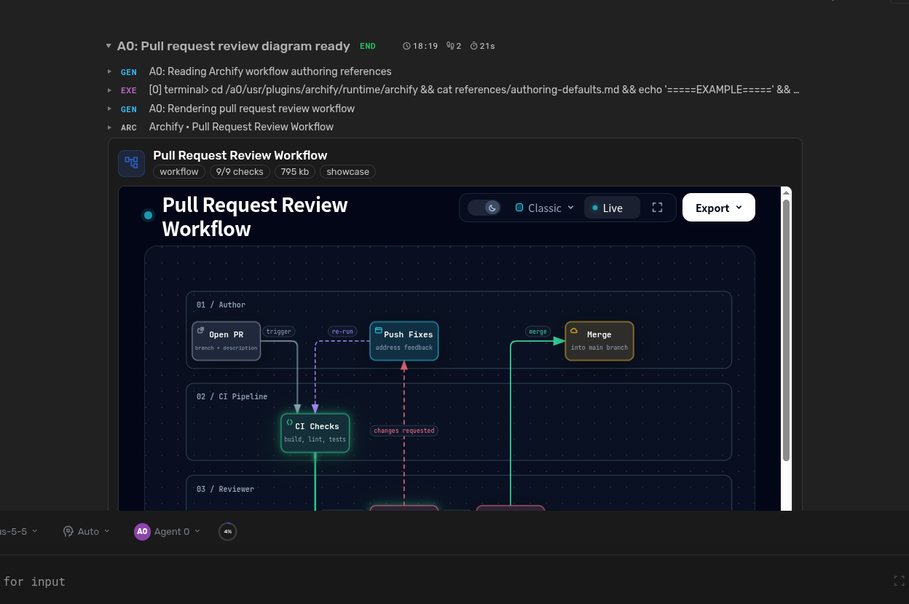

# Archify Diagrams

Ask Agent Zero for a diagram in plain language. The agent uses the `archify_diagram` tool to write typed Archify JSON, validates schema and layout, then renders it locally with the bundled Archify 3.1.0 runtime. Rendering needs no external API or network.

## Features

- **Ten types:** architecture, workflow, sequence, dataflow, lifecycle, ERD, class, tree, timeline, waterfall
- **Chat cards** with live interactive preview (on by default); optional right canvas (off by default)
- **Viewer:** pan/zoom, search, focus, light/dark themes
- **Exports:** PNG, SVG, WebM, plus downloadable standalone HTML
- **Per-project settings** for display, quality and output
- Diagrams stay on disk after uninstall

## Try

- "Diagram our pull request review workflow"
- "Map this service architecture"
- "Show the order lifecycle"

---

Built on [Archify](https://github.com/tt-a1i/archify). MIT licensed; third-party asset notices retained.
